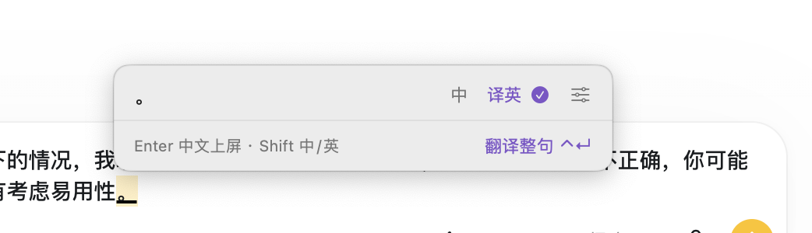

# 方寸输入法输入行为与易用性验收

更新日期：2026 年 10 月 10 日。完整审计版本：本机 build 11，macOS 14.7.4，Intel，Rime 1.17.0。build 12 按用户新确认的规则修正左右键，专项验证见 [候选导航验收](testing/candidate-navigation-build12.md)。

2026 年 10 月 11 日补充：build 13 加入七种双拼，设置、输入边界与专项测试见 [双拼使用与验收](testing/double-pinyin-build13.md)。下文 build 11 审计统计保留，不把新增功能的通过结果当作历史缺陷已修复。

同日 build 14 补充：有拼音候选时支持 `-` 上一页、`=` 或 `+` 下一页，适用于全拼和七种双拼。首末页停住，翻页不确认文字、不调用模型；无候选和英文直输时仍输入符号。专项验收见 [候选翻页验收](testing/candidate-paging-build14.md)。

同日 build 15 补充：长候选完整换行，超长拼音、草稿和译文可滚动查看，光标与高亮候选自动保持可见。原生窗口测试和渲染图见 [长候选与窗口显示验收](testing/long-candidates-build15.md)。

**当前版本还不能视为已通过日常输入验收。** 基本全拼和数字选词能够工作，但部分选词后的确认、输入会话结束、中文草稿编辑仍有明确缺陷。此前的通过项主要证明了几个固定句子的顺序输入，没有证明任意编辑过程都正确，也没有证明候选质量足够好。

本文约定输入状态和按键边界，记录已复现问题，并提供后续修复必须通过的操作清单。下文完整审计统计与失败证据保留 build 11 原始记录；build 12 的候选导航修复不代表这些其他缺陷已经解决。

## 已确认规则与待决定规则

### 已确认规则

- 普通中文模式：空格确认当前高亮候选；整段拼音选完后中文上屏。数字对应当前页的候选。
- 译英开启：中文选词结果进入整段草稿。打字、选词、空格、标点和停顿不调用模型。
- **还有未确认输入时，Ctrl＋Enter 不允许翻译。** “翻译整句”显示“先完成选词”并禁用；原文、候选、光标保持不变。
- 全部选词完成后，Ctrl＋Enter 主动翻译整段一次；请求中重复触发不增加请求。
- 英文译文需要再次确认才上屏；失败保留原文，重试由用户主动触发。
- 左右键按用户补充规则处理：拼音末尾按右键选择下一个候选，左键返回上一个候选；回到全局首项后再按左键才进入拼音编辑。拼音内左右键逐字移动，开头不循环；向右回到末尾后，再按右键继续选词。空格确认高亮项。
- 既支持临时英文直输，也支持中文拼音中夹杂英文。二者必须分别验收。

### 尚未确定的交互

以下项目不能因为代码已经这么做，就当作用户已经认可的规则。

| 项目 | 当前实现 | 需要决定的体验 |
| --- | --- | --- |
| Esc 取消范围 | 有中文草稿和新的拼音时，一次 Esc 清空两者 | 是否先取消当前拼音，再单独取消整段草稿 |
| 译英草稿换行 | Enter 在没有拼音时中文上屏 | 长段落如何输入换行，如何避免与聊天发送键冲突 |
| 仅标点或空白 | 空白不可翻译；单独的 `。` 可以启动翻译 | 仅标点是否直接保留原样并禁用模型请求 |
| 切走应用或点到别处 | 尝试提交原文、清空会话 | 无论最终选择提交还是保留，都必须不丢内容；待译草稿的最终去向需明确 |
| 中文中的网址和代码 | 部分内容被转为中文或中文标点 | 哪些格式自动保留英文，哪些需要明确的英文输入动作 |
| 选错词后重选 | 已进入草稿的文字不能方便地回到候选 | 是否支持重新转换，或者至少先支持可靠的文字编辑 |

## 不同输入状态的含义

“输入框里看到了字”不一定代表已经上屏。下划线中的内容可能仍由输入法管理。

| 状态 | 例子 | 用户此时在做什么 | 是否允许翻译 |
| --- | --- | --- | --- |
| 空输入 | 没有拼音、没有草稿 | 开始输入或使用宿主应用 | 否 |
| 拼音未确认 | `ni hao`，候选“你好”等 | 选择要输入的词 | 否 |
| 部分词已确认 | `你hao` | “你”已选，`hao` 仍待选 | 否 |
| 中文草稿加待选拼音 | `你好` ＋ `shi jie` | 接着写下一部分 | 否 |
| 整段草稿已确认 | `你好，世界。` | 继续写、修改或主动翻译 | 是 |
| 翻译请求中 | 原文保留，显示等待状态 | 等待或返回修改 | 不可重复请求 |
| 英文结果待确认 | 英文译文与中文原文 | 选择上屏内容 | 不自动重复请求 |
| 翻译失败 | 原文与错误原因 | 修改设置、手动重试或中文上屏 | 可手动重试 |

“中 / EN”控制拼音输入还是英文直输；“译英”控制确认后的内容进入待译草稿还是直接上屏。因此“中”与“译英”可以同时开启。当前界面对这两个维度解释不足，容易让用户把“中”理解成“中文直接上屏”。建议明确显示“中文直出”或“中文待译”等状态，但本轮不修改界面规则。

## 按键行为与验收要求

下表的“应当”是验收要求；失败和待决定项不代表已经实现。

| 操作 | 拼音尚未全部选完 | 译英中文草稿已确认 | 英文译文已生成 |
| --- | --- | --- | --- |
| 空格 | 确认高亮候选，仅消费它对应的拼音，保留后续输入 | 加入真实空格，不翻译、不上屏 | 确认当前选中的译文或原文 |
| 数字 1 至 5 | 选择当前页对应项；不存在的序号不能误选其他项 | 输入数字 | 当前实现 1 选英文、2 选原文 |
| 上下键 | 改变候选高亮，不改变用户已确认的文字；首末项停住，不把按键传给宿主 | 是否用于文本移动需与草稿编辑一起设计 | 选择英文或原文 |
| 左右键 | 在候选中前后选择，可跨页；全局首项再向左进入拼音编辑；移回末尾后再向右继续选词 | 应能按文字位置编辑；目前失败 | 当前编辑或退出结果的行为需要补验 |
| `-` / `=` / `+` | 有候选时 `-` 上一页，`=` 或 `+` 下一页；首末页停住，保留拼音光标和已选文字 | 正常追加符号，不翻译 | 按原有继续输入规则返回草稿，不把译文列表当拼音候选翻页 |
| Backspace | 删除光标前内容；已选片段的回退边界需要单测 | 删除光标前一个字符，不应固定删除末尾 | 返回修改后的删除位置需要补验 |
| Delete | 删除光标后的内容 | 同样按真实光标位置删除 | 待补验 |
| Enter | 从未选词时可原样确认字母；部分选词后不能把已选中文全部还原成拼音 | 当前为中文上屏；换行规则待定 | 确认当前选择 |
| Ctrl＋Enter | 拦截，不确认候选、不调用模型、不改变输入 | 翻译完整草稿一次 | 不应产生重复调用 |
| 标点 | 若用于确认候选，应选择当前高亮项而非固定首项；标点只出现一次 | 追加草稿，不发请求 | 继续输入是否先返回草稿，需补验 |
| 轻按 Shift | 切英文时必须保留已选中文与未选尾部；目前有缺陷 | 临时英文进入同一草稿 | 结果失效与恢复规则需补验 |
| Esc | 取消范围必须明确；当前会连已选草稿一起清空 | 是否需要分层取消待定 | 第一次返回原文，不能直接丢原文 |
| Tab 或失焦 | 不允许丢掉光标后的输入；目前失败 | 草稿提交或保留策略待定 | 取消过期结果，不能写入新的输入框 |

普通中文模式没有待译草稿：全段选完即可上屏；空输入时空格、回车和编辑键应交给宿主。不能把这一规则直接套到译英草稿。

## build 11 完整审计结果（保留历史证据）

| 测试层 | 规模 | 通过 | 失败 | 待评审 | 能证明什么 |
| --- | --- | --- | --- | --- | --- |
| Rime 和组句状态 | 73 项，含 22 个首选词样本 | 56 | 9 | 8 | 候选选择、草稿内容、原文保留与翻译准入 |
| IMK 控制器和真实 NSTextView | 6 项 | 1 | 4 | 1 | 文本客户端中的提交、光标和部分宿主回退行为 |

同一个缺陷会在不同模式、不同测试层重复失败，不能把失败项数量当成独立缺陷数量。待评审包含候选质量、尚未确定的交互，以及探索性的格式输入；不等于通过，也不全部等于程序错误。

完整步骤、期望、实际输出见 [逐项测试结果](testing/input-audit-results.md)。可机读的原始结果是 [组句测试](testing/input-behavior-build11.json) 和 [文本客户端测试](testing/client-behavior-build11.json)。本轮不使用真实模型、不读取 API Key、不使用个人词库；只有合成测试语句进入记录。

两层测试都不是系统端到端验收：第二层直接把事件交给实际控制器，并使用 NSTextView，未通过系统键盘路由。之前的系统按键探针因为 macOS 自动按键权限不足而跳过；不能把它写成通过。用户此前确认过 `nihao` 加空格能出现中文，这只覆盖该操作。

## 已复现且应优先修复的问题

### 结束输入会丢掉光标后面的内容

优先级 P0，阻断日常使用。

复现：输入 `nihao`，左移三次到 `ni│hao`，然后点击输入区域、切走会话、在译英模式按 Tab，或关闭译英。多个路径最终只留下“你”，`hao` 消失。

证据：`FLUSH-C/T`、`TAB-TAIL`、`TOGGLE-TAIL`、`CLIENT-CLICK`、`CLIENT-DEACTIVATE`。真实文本视图得到“你”。`flushOriginal()` 强制提交当前转换范围后清空引擎，调用方包括鼠标、失焦和模式切换。修复验收必须覆盖这些入口，不能只修 Ctrl＋Enter 的一个入口。

验收：无论光标在开头、中间、末尾，无论词是否部分确认，离开输入都不能丢失未消费的内容；也不能写入另一个输入框。

### 部分选词后已选中文被还原成拼音

优先级 P1。

复现：`nihao → ←×3 → 空格`，此时是 `你hao`；再按 Enter，实际输出变为 `nihao`。切换英文也有同样结果，普通中文和译英均受影响。

证据：`PARTIAL-RAW-C/T`、`PARTIAL-SHIFT-C/T`、`CLIENT-PARTIAL-ENTER`。当前原样确认直接使用整条原始输入字符串，没有保留已经选定的中文片段。

验收：已确认的“你”必须保留；如果把剩余拼音按原样确认，结果应是 `你hao`。选词过程应保存片段边界，不能只保存“整条拼音”和“整段草稿”。

### 已选中文草稿不能可靠地按光标修改

优先级 P1，直接影响长段落输入。

复现：译英开启，`nihao → 空格 → ← → Backspace`。用户意图是在“你”和“好”之间删除前一个字，保留“好”；文本视图实际保留“你”。

证据：`DRAFT-LEFT`、`CLIENT-DRAFT-EDIT`。草稿只有字符串，没有独立的编辑光标；退格固定从末尾删除。只验证“拼音内左右移动”无法覆盖这一问题。

验收：至少支持草稿中间插入、前删、后删、选区替换，光标在候选窗和宿主中一致；修改前一句不需要清空后面的整段内容。

### 英文混输覆盖不足

优先级 P1。

全新临时词库下，`wozaiGitHubtijiaolePR` 的期望表达是“我在GitHub提交了PR”，实际首选为“我再跟it湖北提交了譬如”，首屏也没有目标整句。`API`、`Bug`、`logo` 的固定用例通过，不能证明任意英文品牌、缩写和大小写组合都能保留。

证据：`Q19`。还观察到中文模式下 `API_v2` 变为 `API_vacancies`，说明数字可能被当成选词序号；邮件和网址的点号也可能变成句号。英文直输模式相同四个格式样本通过，但不能代替中文夹英文能力。

验收：单独覆盖品牌名、缩写、变量名、数字后缀、邮箱和网址；为歧义提供可见的原样英文候选或明确操作，不能静默拆坏已经明确输入的英文词。

## 截图中的单独句号



截图可确认：中文输入与译英同时开启，当前草稿仅显示 `。`，没有拼音候选，却有“翻译整句”入口。截图无法确定之前的完整按键序列，所以不能由它直接断定哪一个词被选错。

本轮找到两条可复现路径：

1. 空草稿、译英开启，直接输入 `.`，得到待译的 `。`，翻译入口可用。
2. 输入“你好”并选词，点击输入区域提交前面的中文，再输入 `.`；文本视图中“你好”已经上屏，只有最后的句号仍被标为待确认内容。

证据：`LONE-PUNCT`、`CLIENT-PUNCT`。第二条路径能产生与截图相同类型的分裂状态，但不能据此确认用户当时一定点过鼠标。

易用性验收：清楚区分已上屏内容与整段待译草稿；普通编辑操作不应让用户不知情地拆开待译范围；只剩标点时不应暗示有一整句中文可翻译。仅标点的最终处理规则仍需确定。

## 各种输入形式的覆盖清单

### 中文与候选

| 场景 | 代表输入或操作 | 必须观察的结果 | 当前覆盖 |
| --- | --- | --- | --- |
| 单字与词组全拼 | `hao`、`nihao` | 首选质量、候选 1 至 5 与实际输出一致 | 已测小样本 |
| 连续整句 | `woxiangqubeijing` | 连续输入、分词、分多次确认一致 | 首选样本已测，广泛分段待补 |
| 多音字与歧义 | `yinhang`、`hangye`、`chongqing` | 词组上下文优先，允许人工改选 | 小样本已测 |
| 隔音与 ü | `xi'an`、`chang'an`、`nvhai`、`lvse` | 词正确；光标不能因字符编码错位 | 基础通过 |
| 简拼与不完整拼音 | `nh`、`zg`、只输入 `n` | 候选合理，未完整音节仍能编辑 | 待补 |
| 拼错后修改 | `nihaoo`，中间退格 | 删除对应字符，完整句子和后续字符不丢 | 固定样本通过 |
| 普通话容错 | n/l、前后鼻音、翘舌混淆 | 是否提供模糊音需明确，不能误宣称支持 | 待定义与测试 |
| 数字选词 | 1 至 5、9 | 当前页映射一致，无效序号不误选 | 两种中文模式已测 |
| 翻页 | 第二页选 2，末页继续翻 | 选当前页，末页行为稳定 | 第二页已测，末页待补 |
| 鼠标选词 | 点击候选、翻页箭头 | 内容与点中的项一致，不意外提交原文 | 选择接口已测，真实鼠标点击待验 |
| 较长的候选 | 多个候选前四字相同 | 能看到区别，不能全部截成一样的省略文本 | 代码显示存在截断，实屏待验 |
| 用户学习 | 多次选非首项、重启后再输入 | 学习合理，顺序可解释，用户词库可保留 | 本轮隔离词库内有学习，持久化和真实体验未验 |

### 中文夹英文和特殊内容

| 场景 | 代表输入 | 验收重点 | 当前覆盖 |
| --- | --- | --- | --- |
| 常见英文词 | `tuopanlidelogo` | 英文单词不拆成同音汉字 | 固定样本通过 |
| 大小写品牌与缩写 | `GitHub`、`OpenAI`、`PR`、`API`、`macOS` | 保留拼写和大小写，不将缩写擅自展开 | 部分通过，GitHub/PR 组合失败 |
| 英文处于句首中尾 | `APIzhichi...` 等 | 切分一致，中文上下文不改变英文内容 | 中间样本少量通过，其余待补 |
| 下划线和数字后缀 | `API_v2`、`foo_bar`、`GPT6` | 数字不误选词，符号不变形 | 中文下有问题，英文直输样本通过 |
| 邮箱和网址 | `test@example.com`、带路径及参数的网址 | `.`、`:`、`/`、`?`、`=` 保留 | 中文下有问题，英文直输样本通过 |
| 数字和日期 | `3.14`、`10:30`、`2026-10-10`、`￥99.5` | 与标点和选词按键无冲突 | 小数样本原样输出，其他待补 |
| 英文原样确认 | `logo → Enter` | 不出现展示用分隔空格 | 未选词状态通过；部分选词失败 |
| 表情与组合字符 | emoji、重音字符、组合 emoji | 退格按完整字符，光标不越界 | 待补 |
| 粘贴和替换选区 | 中文、英文、多行和长文 | 替换范围正确，已有草稿不被覆盖 | 待真实宿主验收 |

### 译英和会话变化

| 场景 | 验收重点 | 当前覆盖 |
| --- | --- | --- |
| 选词未完成就翻译 | 不发请求、不自动代选、不改输入 | 基础与客户端通过 |
| 已确认整段翻译 | 请求原文等于完整草稿，不包含未选拼音 | 既有模拟服务测试通过 |
| 连按触发键 | 同一请求期间只调用一次 | 既有测试通过 |
| 请求途中继续打字 | 旧请求取消或结果作废，新输入不被覆盖 | 既有固定路径通过，其他编辑键待补 |
| 失败和重试 | 原文保留，原位置可继续编辑，不自动重试 | 模拟错误路径通过 |
| 翻译结果选原文 | 原文完整上屏，候选顺序与按键对应 | 既有固定路径通过 |
| 长草稿 | 多次选词和标点不提前上屏，能顺手改前句 | 180 字符存储通过，编辑失败 |
| 多段落 | 段内换行与聊天发送键不冲突 | 规则待定 |
| 超长内容 | 长度限制可理解、可恢复，不清空原文 | 代码有 4000 字符限制，边界待补 |
| Cmd＋A/C/X/V/Z | 选区、复制、剪切、粘贴、撤销不会操作错内容 | 待真实宿主验收 |
| Shift 与组合键 | 单独轻按切换；大写、快捷键、鼠标组合不误切 | 既有控制器测试通过固定序列 |
| Caps Lock 与不同键盘 | 状态一致，符号和英文大小写正确 | 待补 |
| 切应用和切输入法 | 不丢字、不串到新输入框、过期结果不上屏 | 失焦丢字已复现，完整系统流程待验 |
| 点设置和切译英 | 保留输入，说明当前内容如何处理 | 关闭译英已复现丢字；其他入口待验 |

## 易用性测试必须完成真实任务

仅断言某个字段等于“你好”不足以判断可用。每次验收记录目标文字、实际文字、额外操作次数、是否重打、是否出现意外上屏，以及用户是否知道下一步。

| 任务 | 完成标准 |
| --- | --- |
| 输入“明天下午三点开会”，再把“三点”改成“四点” | 只改目标位置；后面的“开会”保留，不需要重打一整句 |
| 第一候选不合适，选择第三候选，再继续输入 | 输出与看到的第三项相同；当前页、序号和高亮没有歧义 |
| 输入“我在 GitHub 提交了 PR，修复 API_v2 的 bug” | 英文品牌、大小写、下划线、数字不被破坏；中文切分可修正 |
| 译英模式写三句话，回到第一句改一个词 | 草稿完整可编辑；最终只翻译修改后的整段一次 |
| 选到一半，临时切去查资料再回来 | 不丢字；草稿是否已提交能看得明白；不会写入另一个应用 |
| 网络请求很慢，继续改字或取消 | 没有旧译文覆盖新内容，也不会迫使用户等待才能输入 |
| 中文草稿后输入句号，再继续下一句 | 前后是否属于同一待译段落清楚，不留下含义不明的孤立面板 |
| 翻译失败后选择中文发送 | 不用重打，原文和标点完整；选择输入内容不能替用户执行聊天发送 |

候选质量需要另建足量语料，并与用户常用输入法在相同目标任务下比较。至少分日常对话、工作表达、人名地名、专业词和中英混输；有歧义的拼音允许多个合理答案。分别记录目标表达的首选命中、首屏可达、需要改选次数和最终文字正确性。

本轮 22 个固定表达中 21 个首选符合目标，**这不是产品总体准确率**。样本少，且多个来自此前的修复用例；后续必须增加独立的新语料，避免只对已见句子表现良好。

## 真实应用验收清单

以下均为待执行项，不能由组句或 NSTextView 测试代替。使用测试文本，不实际发送消息、邮件或执行终端命令。

| 环境 | 重点检查 |
| --- | --- |
| TextEdit 普通和富文本 | 标记文本、光标、选区替换、撤销、段落换行 |
| 浏览器 input 和 textarea | 单行回车、多行回车、Tab 焦点、表单快捷键 |
| 浏览器 contenteditable | 富文本节点变化、光标定位、点击重新定位 |
| 当前聊天输入框及其他 Electron 编辑框 | 候选操作不触发发送、焦点切换、附件附近的定位 |
| 用户常用聊天软件 | 输入、编辑、选择原文/译文；仅检查发送前状态 |
| 代码编辑器和终端的测试输入区域 | 英文符号、Ctrl 快捷键、组合键不被错误拦截 |
| 多屏、缩放、深色模式和全屏 | 候选窗不遮挡关键输入，不越界；长词、错误信息可读 |

每一环境至少执行：普通中文、译英草稿、英文直输、混输、第三候选、第二页候选、部分选词后修改、失焦回来、正在翻译时切换输入框。记录应用版本、键盘布局、输入法模式、是否使用已有用户词库。

## 测试方法与修复顺序

### 可重复运行的测试

```sh
./scripts/audit-input.sh
./scripts/audit-client.sh
./scripts/test.sh
./scripts/controller-test.sh
```

前两个命令会继续跑完所有检查，并输出 JSON；只要有失败就返回非零状态。build 11 的失败退出是本次审计结论，不应删掉失败断言或把错误输出设为正确答案。`REVIEW` 需要人工判定，不能自动算通过。后两个命令保留之前的回归覆盖。

审计使用一次运行专属的临时 Rime 用户目录。首选词语料在任何选词操作前采集，之后真实引擎会学习测试中选过的词。因此“选中哪项就输出哪项”的测试比较**当时实际显示的候选**，不硬编码所有后续 `nihao` 必须输出“你好”；候选质量用另一组目标表达单独衡量。不能把用户词频变化误报成选词按钮错位，也不能用动态比较掩盖候选内容本身不好。

### 修复顺序

1. **先解决内容丢失。** 统一部分确认片段与未选尾部的保留方式，覆盖鼠标、失焦、Tab、模式切换、Enter、Shift。
2. **再解决编辑正确性。** 给草稿完整的光标与选区语义，保证插入、前删、后删、撤销和宿主同步。
3. **补齐候选与英文混输。** 先验证选择操作准确，再评估候选质量；扩充冷启动和已有词库两套语料。
4. **明确待决定的按键规则。** 包括 Esc、换行、仅标点、失焦草稿去向；避免边修边改变用户习惯。
5. **完成真实应用任务验收。** 先通过内容和编辑门槛，再测试候选窗可读性、遮挡、响应延迟和操作成本。

进入日常使用验收的最低门槛：所有确定性内容丢失和错位置编辑问题清零；所有选词操作与所见候选一致；未选完时零模型请求；过期译文不覆盖新输入；关键任务无需整段重打；真实应用矩阵有明确结果。不能以“构建成功”“固定用例全绿”或“某次能打出中文”代替这些门槛。

## 相关代码与证据

- [组句与翻译状态](../Sources/CompositionSession.swift)：原样确认、原文提交、草稿编辑、翻译准入。
- [系统文本控制器](../Sources/InputController.swift)：鼠标事件、失焦、按键转交、标记文本位置。
- [候选窗](../Sources/CandidatePanel.swift)：模式提示、长候选截断、翻译按钮状态。
- [拼音方案](../Resources/translate_type.schema.yaml)：分词、词库、标点和导航规则。
- [本轮组句审计](../Tests/InputBehaviorAudit.swift) 与 [客户端审计](../Tests/ClientBehaviorAudit.swift)。
- [本轮原始结果与完整用例](testing/input-audit-results.md)。
