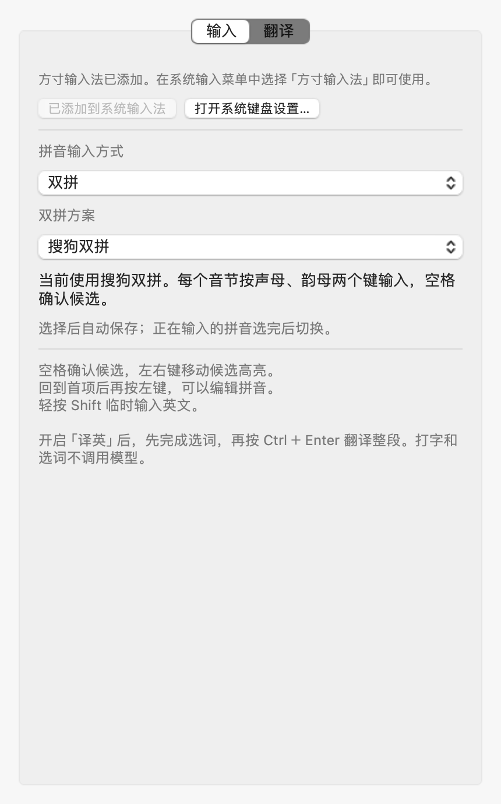
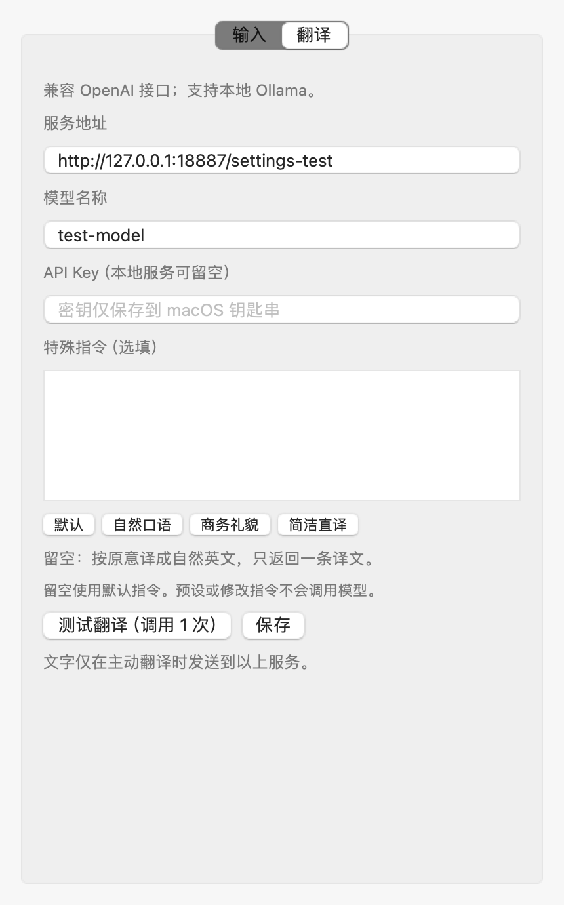

# 双拼使用与验收 · build 13

更新日期：2026 年 10 月 11 日。macOS 14.7.4 / Intel，Rime 1.17.0。

## 怎么开启

打开方寸输入法设置，在「输入」页将「拼音输入方式」改为「双拼」，再选择常用方案。选择自动保存，不依赖模型配置，也不需要重启。系统输入法菜单的「拼音方案」也提供相同选择。

已有用户默认继续使用全拼。切回全拼后再次开启双拼，会恢复上次选择的双拼方案；关闭设置或重新打开输入会话不会重置方案。

| 方案 | 你好 | 中文 | 北京 |
| --- | --- | --- | --- |
| 搜狗双拼 | `nihk` | `vswf` | `bzj;` |
| 小鹤双拼 | `nihc` | `vswf` | `bwjk` |
| 自然码 | `nihk` | `vswf` | `bzjy` |
| 微软双拼 | `nihk` | `vswf` | `bzj;` |
| 智能 ABC | `nihk` | `aswf` | `bqjy` |
| 拼音加加 | `nihd` | `vywr` | `bwjq` |
| 紫光双拼 | `nihq` | `uhww` | `bkj;` |

上述例子输入编码后按空格确认。这里支持的是双拼音码，不包含小鹤音形的形码；本版未收录国标双拼，也不自动混用全拼和双拼编码。



## 原有操作继续适用

- 空格确认当前高亮候选；普通中文模式整段选完后上屏，译英模式加入待译草稿。
- 拼音末尾右键选择下一个候选，左键返回上一个候选；可跨页。回到全局首项后再按左键，才开始编辑编码；移回末尾后再按右键继续选词。
- 只要还有未确认的编码，Ctrl＋Enter 仍然不能翻译。全部选词完成后才能主动翻译整段；输入和选词不调用模型。
- 轻按 Shift 临时英文直输；Enter 可原样输入尚未选词的字母。双拼中的标点仍按中文输入处理；在需要分号韵母的方案中，分号可参与编码，而空输入时分号仍输入 `；`。
- 候选窗显示当前方案简称，例如「搜狗」「小鹤」，英文直输时显示「EN」。

切换方案时还有未选完的输入，会先保留原方案的编码、候选和光标，等这一段确认或取消后再应用新方案。**切换本身不会强制代选、上屏或清空中文草稿。** 多次更改只应用最后一次选择；选回当前方案会取消待生效的切换。

## 中文夹英文

英文单词保留原有英文编码和大小写，不经过双拼键位转换。双拼的短编码与英文重码较多，不能把首选候选永远当作用户想要的英文。

例如搜狗方案连续输入 `nihklogo`，可能首选「你好落果」。可以先选择候选「你好」，再在剩余部分选择英文候选 `logo`，最终得到「你好logo」，不用切换输入语言。也可先完成中文选词，再输入英文并确认英文候选，或用 Shift 临时英文直输。

测试验证了「中文前缀＋logo」连续输入后的分段选词，以及 `API` 大写英文候选、Enter 原样输入 `logo`、英文直输 `App_v2;`。这不代表任意品牌、网址、代码都能自动排到首位；原有输入审计中的混输质量问题仍需单独修复。

## 已执行验证

使用专属临时 Rime 用户目录和合成测试语句，不使用个人词库或真实模型服务。

| 测试 | 结果与边界 |
| --- | --- |
| 七种方案的固定编码 | 「你好、中文、北京」候选与空格确认通过；覆盖 zh、韵母差异及分号韵母 |
| 零声母与标点 | 各方案对应的「啊」编码可选择；空输入分号仍为中文标点 |
| 普通中文／译英双模式 | 左右跨页、空格确认高亮项、内部插入退格、回末尾确认通过 |
| 英文混输 | 连续中文夹英文的分段选择、英文大小写、原样字母和英文直输通过 |
| 翻译准入 | 未完成选词时无请求、无密钥读取；完成后草稿正确且允许主动翻译 |
| 更改方案 | 编辑中延后切换、已确认草稿保留、全拼与双拼互切、取消待切换、连续更改、Enter／Esc 结束后应用新方案通过 |
| 配置 | 旧配置默认全拼，未知方案回退全拼，再次进入双拼记住上次方案 |
| 实际控制器＋NSTextView | 搜狗输入中请求切换小鹤，旧编码正常确认，后续小鹤编码正确上屏；恢复会话后保持方案 |
| 原生设置表单 | 全拼／双拼切换、下拉框启用状态、恢复上次方案、选搜狗后直接输入均通过；无需填写模型信息 |
| 全拼与翻译回归 | 原有核心回归最终全部通过；完整保留候选导航、未选完阻止翻译、模拟 HTTP、缓存、取消和失败回退检查 |

运行入口：

```sh
./scripts/double-pinyin-test.sh
./scripts/controller-test.sh --capture-settings .build/build13-settings
./scripts/test.sh
```

双拼测试报告 179 次通过断言，控制器报告 18 个通过检查，并包含未单独打印的选区、标记文本与表单状态断言。这些计数含重复模式和循环，不是输入准确率，也不是独立真实用户任务数量。

原有核心回归首轮并行执行时，在第二次模拟翻译处出现断言失败。增加错误信息后单独复测全部通过，未修改翻译请求实现；首轮日志没有具体网络错误，根因尚未确认。日志保留在 `.build/build13-core-tests-first.log`，最终结果在 `.build/build13-core-tests.log`。

设置的「翻译」页也已渲染检查，模型、API Key、特殊指令和保存按钮均完整显示：



这些测试直接调用 Rime 或向实际 IMK 控制器投递事件；没有经过 macOS 系统键盘路由，不能代替各聊天软件、浏览器与编辑器中的真实按键验收。本次没有申请额外系统权限。build 11 已记录的失焦丢尾部、部分选词后 Enter 还原编码、整段草稿编辑等问题，不因加入双拼而算作已修复，见 [完整输入审计](../input-behavior-and-usability.md)。

## 方案来源与构建

键位来自 [iDvel/rime-ice](https://github.com/iDvel/rime-ice/tree/da1fbe602e38f26db846fa10120ee64c2b0324c0)，固定提交 `da1fbe602e38f26db846fa10120ee64c2b0324c0`，仅采用拼写运算，未引入上游 Lua 功能或界面配置。许可证为 GPL-3.0，保留于应用资源的 `RIMEICE-LICENSE.txt`。

`scripts/double-pinyin-layouts.json` 保存来源、SHA-256 和映射。`scripts/prepare-double-pinyin.py` 从这些固定规则离线生成七种方案，使用独立键位索引、共享双拼词库，并在双拼转换完成后恢复受保护的英文编码。现有全拼词库和用户学习记录保持原路径，双拼学习使用单独的 `fangcun_double` 用户词库。

安装核验通过：本机已更新为 build 13；程序、默认方案列表、双拼词库和七个方案文件均与构建产物一致，代码签名校验通过。七种方案均已在本机 Rime 用户目录完成部署；系统原有方寸输入源仍启用且可选，只保留一个安装进程。安装保留原系统输入源选择，本次核验时仍为搜狗输入法；需切回方寸才能使用新功能。
