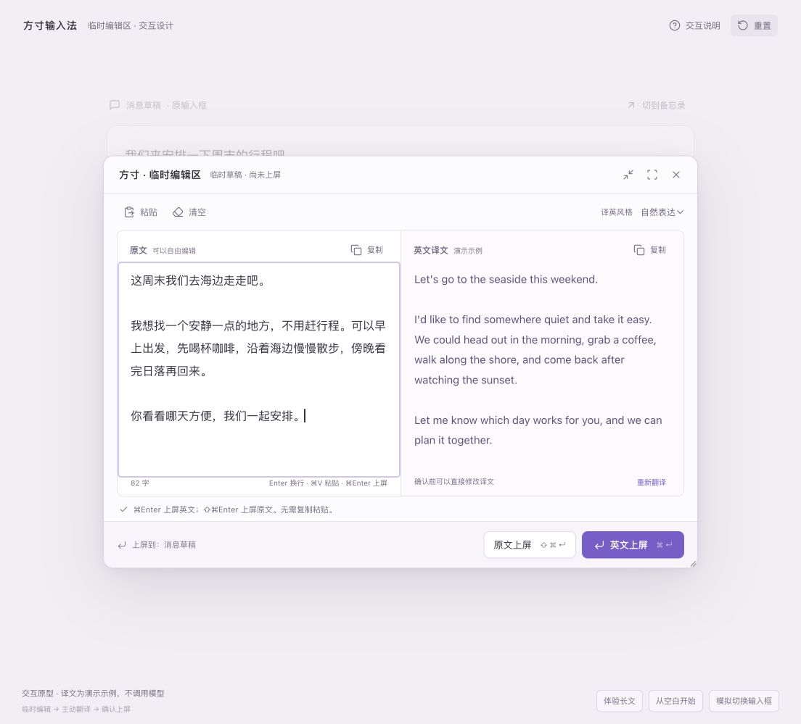

# 临时编辑区快捷上屏 · build 17

日期：2026-10-11。此前只有「原文上屏 / 英文上屏」按钮，键盘流程到翻译后中断；现在原生编辑区和 HTML 原型都支持直接快捷上屏。

| 快捷键 | 行为 |
| --- | --- |
| Ctrl + Shift + Enter | 打开临时编辑区；原生版可在设置中修改 |
| Enter | 完成选词后换行 |
| Ctrl + Enter | 主动翻译 |
| Cmd + Enter | 有译文则提交修改后的译文，否则提交原文 |
| Cmd + Shift + Enter | 明确提交原文，即使已经有译文 |

原文和译文区均可直接触发。提交通过保存的 IMK 客户端写回原输入位置，保留周边文字和原选区替换语义，随后收起窗口；不会复制、模拟粘贴或向原应用发送 Enter。

未选完拼音时保留候选、禁止提交。翻译中 Cmd + Enter 等待结果，避免将用户期待的英文意外换成中文；Cmd + Shift + Enter 则明确提交原文并取消待返回的翻译。译文被清空后，Cmd + Enter 不自动退回原文。原输入框或光标改变后仍要求确认；失败保留草稿。

## 验证

`./scripts/editor-test.sh` 共 **71 项通过**，包含此前 56 项及新增 15 项。新增内容覆盖：两种快捷键等待选词、额外修饰键不误触、重复按键不重复提交、数字键盘 Enter、翻译中等待及强制原文提交、迟到响应保护、原文和译文焦点、修改后的多行 Unicode 译文、替换原选区、空原文/空译文、全程剪贴板版本不变。原有输入框切换和光标变化测试也改为通过快捷键触发。日志：`.build/build17-editor-tests.log`。

原生测试使用真实 AppKit 文本视图、Rime 和本机模拟翻译接口，通过窗口 `performKeyEquivalent` 和文本控件 `keyDown` 检查行为；没有操控外部应用，也没有请求个人模型服务。系统向原生浮窗投递快捷键、外部应用的 IMK 代理在失焦后是否仍可写，仍需实际应用验收。

浏览器原型实际验证了 Cmd + Enter 上屏中文、Ctrl + Shift + Enter 打开、Ctrl + Enter 翻译，以及在译文区按 Cmd + Enter 回写英文。结果显示「已上屏 · 尚未发送」，焦点回到模拟原输入框。原型内容是固定演示示例，不代表真实模型响应。

已安装 build 17，安装产物与本轮构建二进制一致，深度代码签名校验通过。系统中的「方寸输入法」已启用且可选，只有一个已安装进程。安装保留当前 ABC 输入源；使用原生功能时需先切到方寸。安装日志：`.build/build17-install.log`。

