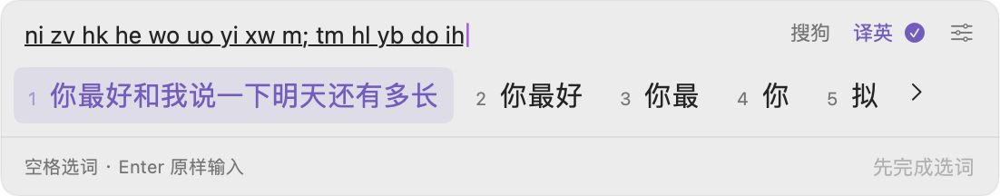
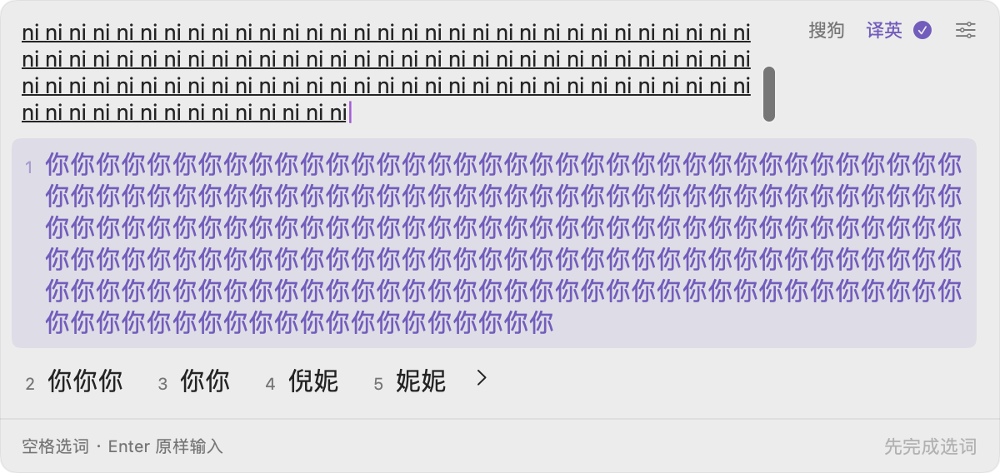
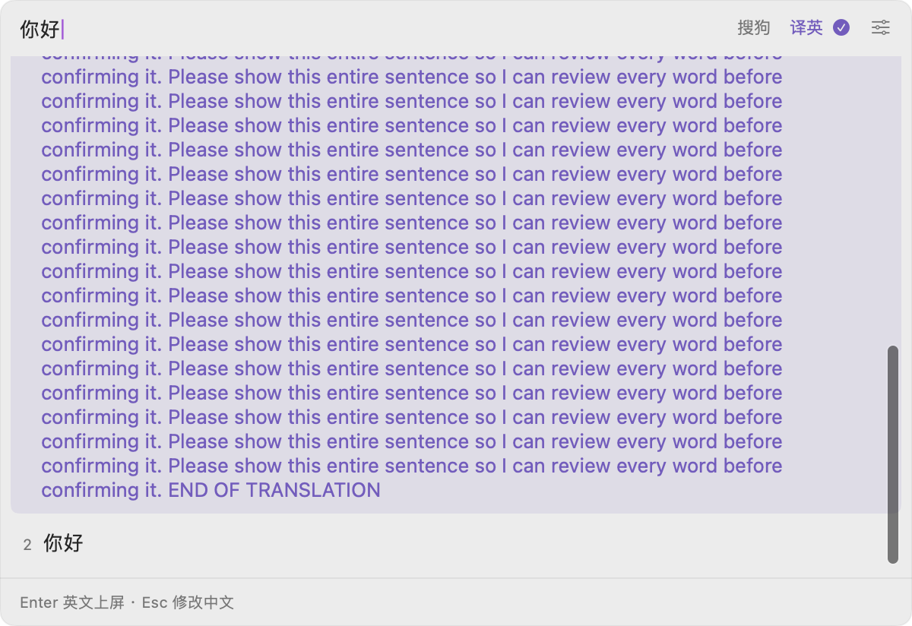

# 长候选与窗口显示验收 · build 15

日期：2026-10-11。环境：macOS 14.7.4 / Intel，Rime 1.17.0。

## 修复

此前候选视图直接截取首选的前 8 个字符、其余候选的前 4 个字符，再添加省略号，导致选择之前无法读到完整句子。预编辑区也限制为单行，窗口没有处理超过屏幕高度的内容。

build 15 显示完整候选文字。短词横排，长句按实际宽度换行，后续候选自然排到下一行；候选编号、键盘顺序、空格确认和加减号翻页规则保持一致。窗口最长宽度为 600 点，高度限制在 420 点及可用屏幕范围内，超长内容在候选区域滚动查看。键盘切换高亮项时自动滚到该候选。

待确认输入区同时保留已选中文草稿与新拼音，最多显示四行，剩余内容可滚动查看；继续打字或左右编辑拼音时自动显示光标。渲染复用窗口时显式刷新当前内容，避免候选列表残留上一段输入。窗口仍不获取键盘焦点。

截图中同样的搜狗双拼输入，现可完整读到「你最好和我说一下明天还有多长」：

长拼音自动跟随光标；200 个 `ni` 的压力样本中，完整首选分行显示，其余候选仍可选择：

本机模拟服务返回的长译文，可滚动看到末尾标记和中文原文：

## 已执行验证

| 入口 | 检查内容 | 结果 |
| --- | --- | --- |
| `./scripts/panel-test.sh` | 截图同款双拼长句、完整选词、长拼音全文与光标跟随、草稿加拼音、长译文滚动与选择、完整上屏、屏幕边界 | 17 个打印检查通过，另含窗口边界和模型结果前置断言 |
| `./scripts/controller-test.sh --capture-navigation .build/build15-short.png` | 实际 IMK 控制器和 NSTextView，中文确认、Shift、左右导航、八种方案、加减号与 Page Up / Down | 33 个打印检查通过 |
| 已编译的控制器测试 `--capture-settings .build/build15-settings` | 上述检查，以及翻页回归之后再次切换设置表单方案并输入 | 34 个打印检查通过 |

测试使用专属临时词库，长译文来自 `Tests/mock_server.py` 的本机模拟接口，不使用个人 API Key，不调用真实模型。测试直接检查原生视图、滚动位置及实际提交的全文，并渲染窗口图片人工核对；没有通过 macOS 系统按键路由操控外部聊天软件。

日志在 `.build/build15-panel-tests.log` 和 `.build/build15-controller-tests.log`。测试过程中发现并修复了复用视图候选未更新，以及布局尚未完成时滚动无法跟随光标的问题；最终版本两项均完成回归。

本机已安装 build 15，程序与构建产物哈希一致，代码签名校验通过。原有系统输入源仍启用且可选，安装进程仅一个。设置回归和安装日志分别位于 `.build/build15-settings-tests.log`、`.build/build15-install.log`。

本次改善展示和查看方式，不把已有的中文草稿编辑、失焦丢尾部、部分选词后 Enter 还原编码等历史缺陷标为已修复，详见 [完整输入审计](../input-behavior-and-usability.md)。
