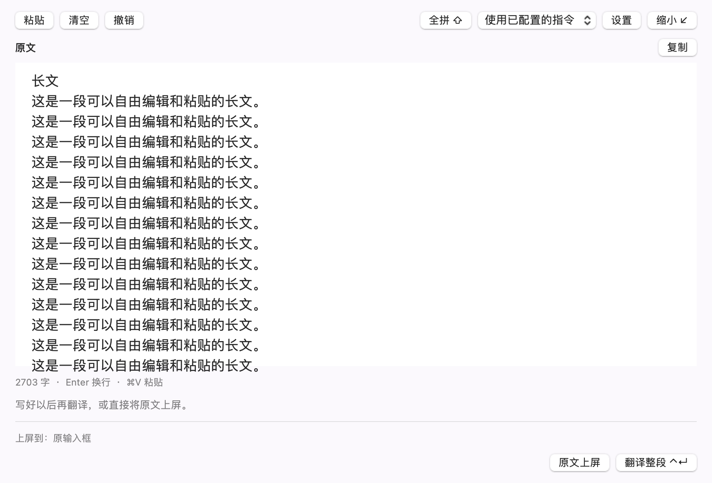
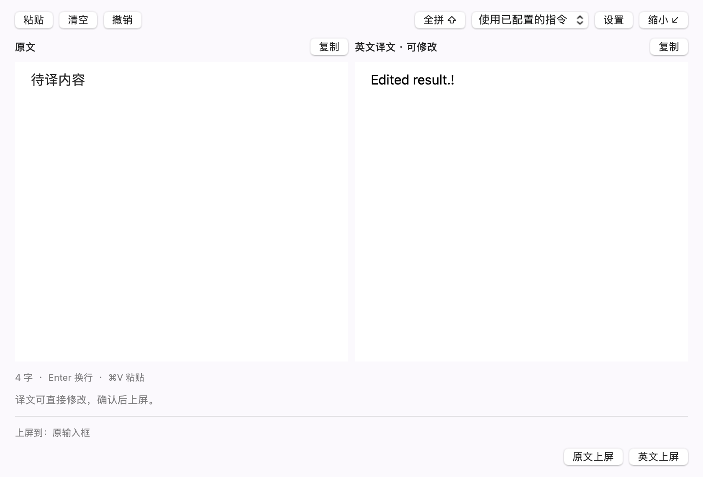

# 临时编辑区 · build 16

日期：2026-10-11。环境：macOS 14.7.4 / Intel，Rime 1.17.0。

## 使用

选中方寸输入法，在原输入框按 **Ctrl + Shift + Enter**，或点击候选窗放大按钮、系统输入法菜单「临时编辑区…」。没有正在输入的文字也可打开。设置的「输入」页可以录制其他快捷键；这是输入法内快捷键，没有安装全局键盘监听。

临时编辑区是可拖动、缩放的原生浮窗。中文直出或译英模式都可以打开，窗口内先暂存内容，不修改全局译英开关。

| 场景 | 行为 |
| --- | --- |
| 打开时有未选拼音 | 带入同一 Rime 会话、候选及插入位置，不自动选择候选或翻译 |
| 全拼 / 双拼 / 英文混输 | 继续使用现有 Rime 引擎；空格、数字和左右候选操作延续输入法规则 |
| 选词完成后 Enter | 换行；有待选拼音时保持既有 Enter 原样输入编码的行为 |
| Cmd + V / 粘贴 | 在光标处插入，或替换选区；有待选拼音时提示先完成选词 |
| 选区编辑、退格、方向键 | 无候选时按原生多行文本编辑规则工作，保留后续文字 |
| Cmd + Z / Cmd + Shift + Z | 原文撤销 / 重做；待选拼音期间不改写草稿历史 |
| Ctrl + Enter | 选词完成后主动翻译；请求中防止重复调用 |
| 原文或风格变化 | 旧译文失效，不自动请求；使用已配置特殊指令或本段预设 |
| 翻译完成 | 显示原文与可编辑译文，可分别复制 |
| 原文上屏 / 英文上屏 | 明确选择后向原输入位置提交一次；不发送消息 |
| Esc | 有待选拼音先取消本次合成；否则缩回候选窗，保留中文草稿 |
| 关闭窗口 / Cmd + W | 收起并保留草稿；中止进行中的请求；再次快捷键恢复 |
| 缩小后切走应用 | 将该编辑区草稿收起保存，不自动选词或提交 |
| 切换输入框 / 原光标变化 | 禁止误写其他位置；返回原输入框或明确确认当前光标后继续，始终可复制 |

原文使用独立撤销历史，避免程序更新预编辑串时污染 NSTextView 的原生撤销栈。译文使用原生文本编辑。目标位置保存原 IMK 客户端、选区及邻近文本；上屏仍走 IMK `insertText`，没有模拟粘贴或辅助功能输入。

草稿保存在本次输入法进程的内存中；退出、崩溃或升级不保证恢复。当前同时保留一个独立临时编辑区。上屏后的跨应用撤销交给原应用，尚未实现原型中的统一短暂撤销。浮窗最小尺寸为 700 × 430 点，采用原生文本区，没有实现原型的窄屏标签布局。

整段翻译上限为 20,000 字；超出后禁用翻译并提示分段，文本保留且仍可编辑、复制、原文上屏。超过 4,000 字的请求等待时间为 90 秒，短文仍为 25 秒。服务本身可能有更低的上下文限制，失败会保留原文并显示错误，不自动重试。

## 自动验证

| 入口 | 检查数 | 本轮结果 |
| --- | ---: | --- |
| `./scripts/editor-test.sh` | 56 | 通过；真实 Rime、原生 IMK 控制器、AppKit 文本视图与本机模拟翻译接口 |
| `./scripts/test.sh` | 282 | 通过；普通输入、译英状态、调用次数及接口异常回归 |
| `./scripts/controller-test.sh --capture-settings .build/build16-settings` | 34 | 通过；控制器输入、Shift、候选导航、方案切换和设置表单 |
| `./scripts/panel-test.sh` | 17 | 通过；长候选、滚动、原生浮窗边界与完整上屏 |

新增覆盖包括：带未确认拼音打开；阻止未选完翻译；在段落中间和选区内输入；Enter 后继续选词；粘贴 Unicode 多行内容及撤销重做；不同输入框和光标变化保护；关闭、缩小、失焦、重新打开；七种双拼各自选词；英文直输和混输；修改译文；修改原文使旧结果失效；主动取消与迟到响应；超过原 4,000 字限制；20,000 字上限；中文直出模式仍暂存编辑；自定义快捷键与数字键盘 Enter。

测试使用隔离的偏好域和临时 Rime 用户目录，不读取个人模型密钥。剪贴板测试保存并恢复既有内容。所有翻译请求均发往本机模拟接口，本轮未测试用户实际模型服务的长文延迟或输出质量。

日志：`.build/editor-tests.log`、`.build/build16-core-tests.log`、`.build/build16-controller.log`、`.build/build16-panel-tests.log`。

以下图片由原生视图渲染，展示长文滚动和可修改的译文；不是 HTML 截图。图片不包含系统标题栏，PDF 渲染也不完全保留窗口材质。

## 系统会话验收边界

已安装到 `~/Library/Input Methods/FangCun.app`，核实 `CFBundleVersion = 16`，安装文件与构建文件的 SHA-256 一致，深度代码签名验证通过；只有一个已安装输入法进程。原有「方寸输入法」输入源启用且可选，安装保留当前 ABC 输入源。安装日志为 `.build/build16-install.log`，旧应用由安装脚本保存为 `.build/FangCun-previous-*.snapshot`。

上述检查通过程序直接调用原生控件和输入控制器，未向外部应用自动投递 macOS 键盘事件。真实应用中的快捷键拦截、非激活浮窗焦点、原 IMK 代理在失焦后的可用性，还需要实际输入框验收。注册成功、代码签名通过不能替代这些检查。

本机人工验收建议：在常用聊天框里打开编辑区，输入 `nihao` 加空格和换行；粘贴一段多行中文，完成选词后翻译；修改译文并点英文上屏。再分别测试缩小后继续输入、关闭再打开、切换到另一个输入框后上屏被阻止。编辑区无法确认原目标时保留草稿，优先使用复制。

既有普通候选窗的失焦尾部、部分选词原样输入等历史问题不因此整体标为修复，继续按 [输入行为审计](../input-behavior-and-usability.md) 跟踪。
